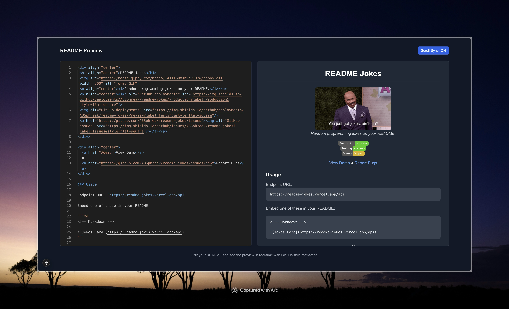

 <h1 align="center">README Tester</h1>
 
<i>A simple place to write and test your README / Markdown doc.</i>

## Features

- Write and test your README / Markdown doc
- Preview your README / Markdown doc
- Sync scroll between editor and preview
